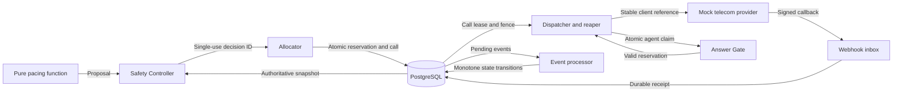
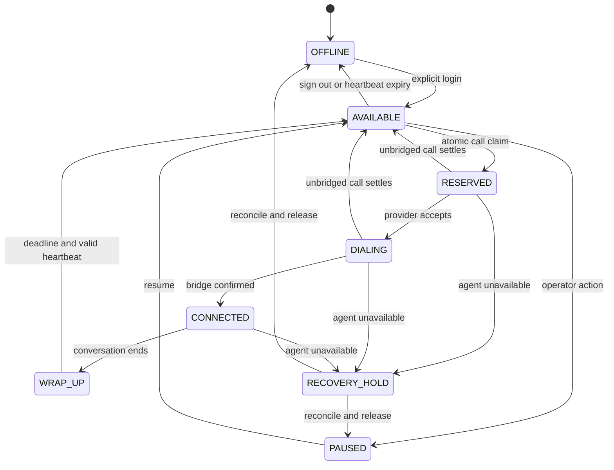
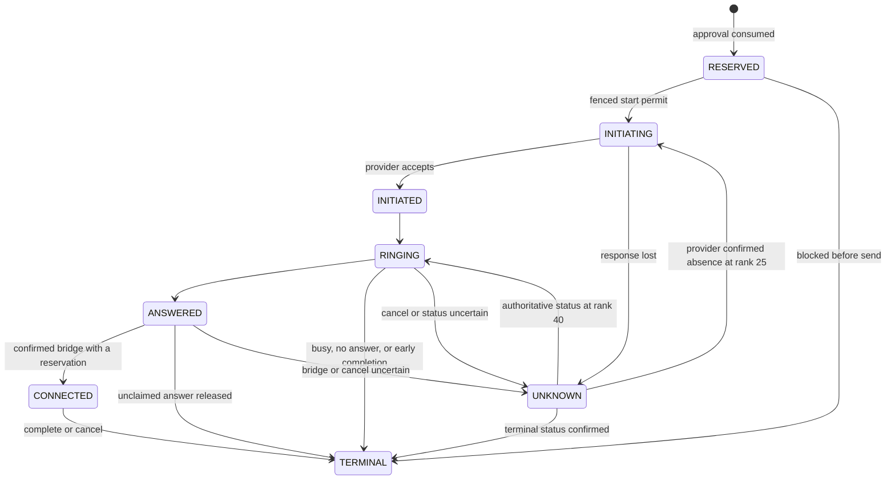

# SmartDialer v3 architecture decision

## PostgreSQL owns admission and reservations

The dialer reads a pacing snapshot and passes it to a pure function. Safety reads PostgreSQL independently, limits the requested volume by current eligible agents, the campaign concurrency cap, and the provider admission limit, and records the inputs and reasons. The allocator receives a decision ID and repeats the eligibility and cap checks in the transaction that consumes the decision. Both admission and dispatch enforce a rolling one-second cap per campaign and provider. Dispatch serializes its start permits using a transaction-scoped advisory lock and counts those permits in the audit log.

Allocation locks the campaign row to serialize the count used by the campaign-wide caps. It then locks eligible agent and borrower rows with `FOR UPDATE SKIP LOCKED`. A locked candidate is skipped, and a committed candidate in `RESERVED` fails the eligibility predicate on the next scan. Two transactions therefore cannot select the same candidate for reservation. A batch can be shorter when a row is locked or the borrower queue runs out. The transaction inserts one call, updates both owners, and consumes the approval together. [PostgreSQL 16 locking clauses](https://www.postgresql.org/docs/16/sql-select.html#SQL-FOR-UPDATE-SHARE)

Partial unique indexes enforce one active call per agent and one active call per borrower. Deferred foreign keys check at commit that each active agent-bound call and its agent point at each other. The call row is the future dispatch outbox. An insert trigger checks the approval ID, campaign, mode, budget, and the PostgreSQL transaction ID that consumed the approval, so a later transaction cannot use the same approval. [PostgreSQL 16 transaction ID functions](https://www.postgresql.org/docs/16/functions-info.html#FUNCTIONS-PG-SNAPSHOT)

A normalized phone number belongs to one borrower row globally. Duplicate enrollment in a second campaign is ignored. Suppression locks and changes that canonical row. It wins against future eligibility checks and survives call settlement if suppression happens after admission.

## State and failure behavior

Agent and borrower updates compare the expected state and version. Heartbeat expiry moves a reserved agent to `RECOVERY_HOLD` and preserves the call binding until the call is reconciled. A fresh heartbeat cannot bring an `OFFLINE` agent back without explicit login. Calls advance by rank, including terminal jumps when an earlier event is missing. The first terminal transition releases the agent and settles the borrower in the same transaction. `ANSWERED` records that the borrower picked up. `CONNECTED` requires a fresh bound agent and a prior answer.

PostgreSQL makes the reservation and settlement atomic. It also makes one busy campaign's row lock a throughput limit. The allocator performs ordered scans of eligible rows and does work per pair while holding that lock. Measure lock waits and batch duration before considering more complex counters or set-based writes.

| Omitted technology | Cost in this prototype |
| --- | --- |
| Redis | A second view of reservation state with invalidation and failover logic. Reservation checks still need PostgreSQL. |
| Kafka | Another durable log and a handoff from the database transaction, plus consumer offsets and replay operations. The call and event rows already provide those durable inputs. |
| Kubernetes | Deployment manifests, probes, cluster access, and debugging infrastructure for a local prototype. |
| Microservices | Network contracts, version coordination, and partial failures across boundaries that currently fit in one process and database. |
| ML | Training data, calibration, monitoring for drift, and harder-to-explain safety inputs. Counts and explicit statistical bounds are sufficient for the design. |

## Dispatch and event processing

The dispatcher claims a call row with `FOR UPDATE SKIP LOCKED` and commits a lease with a monotonically increasing fencing token. It sends the committed call's idempotency key as the client reference. Each provider response accesses the call through an unexpired lease check under a row lock before it can change status or release the lease. Provider calls run outside that transaction. Concurrent workers may repeat a request when its outcome is uncertain. They can only resend an initiation after the original provider confirms the reference is absent. The durable call row, lease, and provider idempotency give at-least-once execution with idempotent processing and reconciliation. Exactly-once execution across PostgreSQL and an external provider is outside the design's guarantees.

An uncertain start, cancel, bridge, or status query uses `UNKNOWN` with the last known rank. The dispatcher applies exponential backoff with full jitter. It records an exhausted start as terminal `FAILED` with `DISPATCH_DEAD_LETTER` and an audit entry only once it knows the provider has no call. If status remains unavailable, PostgreSQL retains ownership until reconciliation succeeds. Healthy active calls are polled so a lost terminal callback can settle the call.

The webhook authenticates the exact body before parsing it. It commits a receipt before returning 2xx and returns 503 on a failed database insert. Event IDs are unique per provider. For providers without an ID, the fallback is SHA-256 over the JSON array `[provider_call_id, event_type, UTC timestamp, sequence]`. Signed malformed or unresolved events are stored and audited. Event processors claim pending rows with `SKIP LOCKED` and commit the transition and receipt disposition together. A late `ANSWERED` record can contribute to derived abandonment metrics when it falls within an unbridged terminal call's lifetime, without reapplying settlement.

The reaper moves expired reservations into `RECOVERY_HOLD`. Before an answer, the dispatcher cancels and confirms the result before releasing ownership. After an answer, it locks a replacement agent and rebinds the same call at most once within the hold deadline. If it cannot reassign the call, confirmed release counts as abandonment. The mocks check the lease at initiation, bridge, and cancellation acceptance. The bridge also checks the current agent reservation in that transaction. A future real adapter would need to support an equivalent fenced handoff to preserve those guarantees across the external boundary.

The mocks store their provider-side acceptance, cancellation, bridge, profile and callback delivery records in the `mock:A` and `mock:B` namespaces of `call_events`. Their commits are independent of dispatcher commits. This keeps restart tests durable without a second service or table. These records do not enter the webhook processor and are excluded from webhook metrics. It models a provider that survives a worker crash. It does not model independent provider storage surviving a PostgreSQL outage.

## Predictive decisions and their limits

Pacing uses the larger of the EWMA and the recent Wilson upper bound. It estimates expected in-flight answers as `p × in_flight` and requests `floor((free + forecast − expected answers) / p)`, clamped at zero and the batch limit. Ten free agents, three in-flight calls, and `p=0.5` give `floor((10 − 1.5) / 0.5) = 17`. A hard-only controller can approve at most ten. The decision stores both views of the inputs, so the request and the cutoff can be reconstructed.

Safety independently computes its own probability from the recent window, an older disjoint reference window, and the EWMA. A moderate upward shift increases the probability, and a large shift in either direction falls back. Missing, stale, and sparse samples also fall back. Safety uses observed answer-latency p1 for the risk horizon and p50 for borrower pre-staging. A committed wrap-up release must already be due, and the agents and borrowers are checked again before allocation. The pre-staging record contains borrower IDs and a wake-up time without allocating calls or holding agents.

Hard and speculative counts are recorded separately in each approval. The allocator rechecks the counts and consumes the approval in its reservation transaction. A follow-up Alembic migration enforces the original capacity class and rejects speculative inserts against hard-only approvals on databases installed during Phase 2. For speculative exposure, Safety applies the binomial survival function to existing and proposed unbound attempts. It subtracts booked hard capacity and already-unclaimed answers before estimating how many seats remain. It preserves headroom for existing speculative exposure before admitting additional hard calls in predictive mode. [SciPy binomial distribution](https://docs.scipy.org/doc/scipy/reference/generated/scipy.stats.binom.html)

The binomial model assumes the selected answer probability and independence across attempts. Shared shocks, early answers, and wrap-up failures can invalidate those assumptions. Speculation can bound modeled probability and observed abandonment rates. A deterministic guarantee against unassigned answers requires hard capacity. Even the p1 timing forecast is empirical. A deterministic lead-time claim would need an actual lower bound on answer latency. That optional claim is deferred.

The abandonment guard uses a rolling Wilson upper bound, a minimum sample size, a lower threshold for resuming speculation, and a cool-down. A first attempt to claim a seat that finds nobody available counts once, even if short hold later connects. The agent-drop rule compares both available and staffed counts over its window. This distinguishes losing 40 free agents from making 40 normal reservations. The decision records a durable cutoff for cancelling existing unbound speculative calls and rejects new admission during the drop window. Agent-bound calls keep their reservations.

The breaker uses recent transport outcomes and setup latency from `call_events` and `calls`. It is evaluated per campaign and provider. `OPEN` blocks new starts. `HALF_OPEN` admits a bounded number of hard probes through Safety and allocation, and a failed probe reopens it. Successful probes restart the health window. Existing bridged calls keep their agents and continue to receive events during a provider outage. The dispatcher still reconciles calls in flight.

The least certain parts are calibration during sudden shifts and the guarantees a real provider could make at bridge time. The mocks verify the fence and the reservation inside PostgreSQL. A real adapter needs an equivalent handoff plus authoritative absence and cancellation by client reference. The utilization and load numbers apply to the tested synthetic workload.

## Architecture and state machines

A terminal status may jump ahead from any active rank. `UNKNOWN` retains the last known rank. An authoritative status query can restore that rank. Webhook replays at the same rank are stale and do not repeat settlement.

## Scaling from 100 to 100,000 agents

| Agents | Likely first limit | Change after measuring |
| --- | --- | --- |
| 100 | Polling and the campaign admission lock dominate small batches. A burst of signed callbacks competes with leasing for PostgreSQL connections. | Keep transactions short. Measure pool wait, campaign-lock wait, and the age of the oldest dispatch and inbox work. |
| 1,000 | Heartbeats update hot `agents` rows, creating dead tuples and vacuum work. A busy campaign's `SKIP LOCKED` query scans more occupied or locked candidates. | Separate liveness writes from reservation rows when MVCC churn justifies it. Batch reservation updates and inspect the eligibility plans and lock waits. |
| 10,000 | One pacing loop per busy campaign and the admission lock serialize too much work. Each callback adds an inbox insert, a processing update, and state or audit writes. | Use a campaign advisory leader and partition allocation by campaign or independent agent pool. Batch event processing and partition `call_events` for retention. |
| 100,000 | Event retention, WAL volume, and analytical queries compete with reservation traffic. Sharding by campaign moves phone deduplication and provider limits across shard boundaries. | Archive cold events and use read replicas for metrics. Keep reservation decisions on the authoritative shard and preserve a global suppression and deduplication authority. Enforce provider-wide limits where campaigns share a provider account. |

A separate liveness table or TTL store could absorb high-frequency heartbeat traffic at scale. PostgreSQL would still own agent assignment. The prototype uses the current schema and a single database. The load results measure the local pipeline and do not establish capacity at the larger tiers.

## What another week would buy

Repeat the calibration with longer warm-ups and independent seeds, and compare against the live worker's polling cadence. Record query plans and lock wait distributions per campaign. Test retention, checkpoint pressure, and a provider adapter against explicit guarantees about cancellation, fencing, and earliest possible answer. The mock shares PostgreSQL with the dialer, so independent provider storage failure and network partition behavior remain outside this verification.
