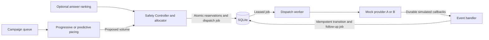
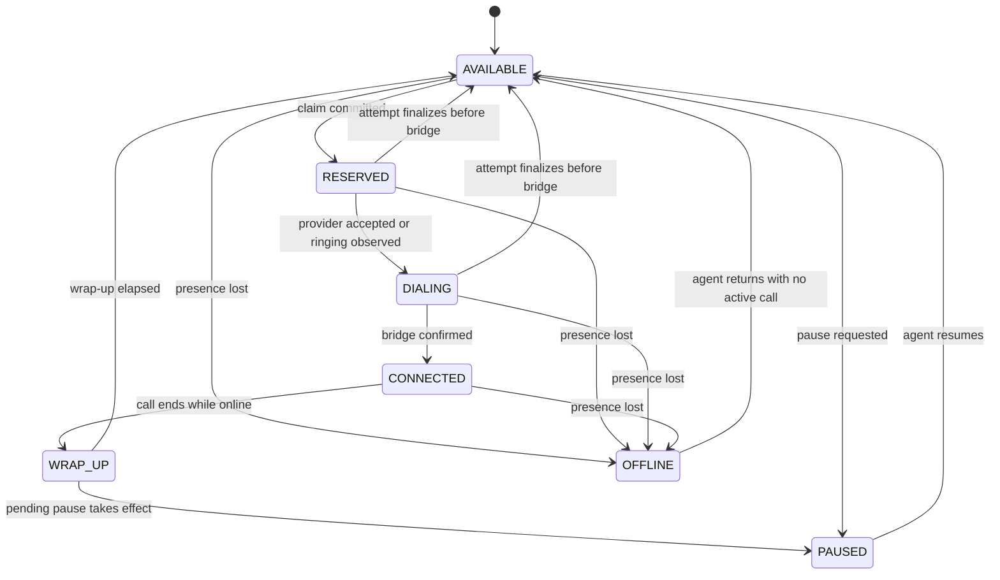
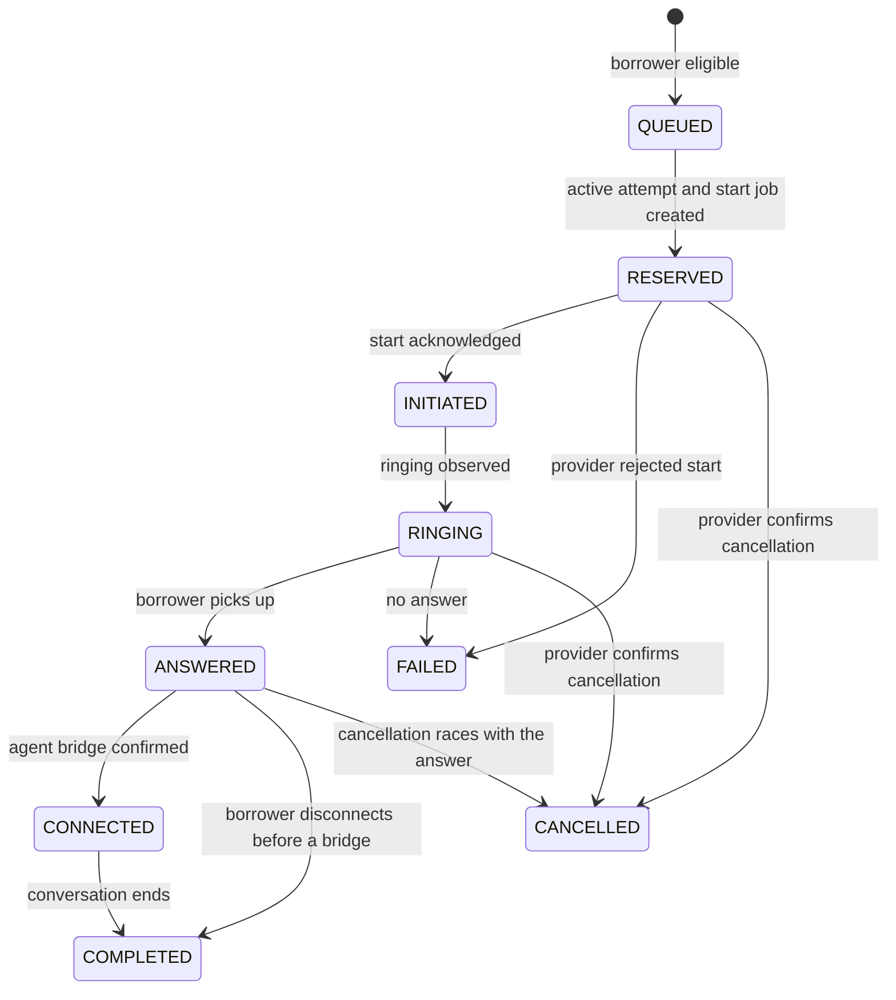

# Architecture and decisions

## Request flow



**Database.** This checkout uses the plan's SQLite fallback. Docker returned HTTP 500 during setup, so a local PostgreSQL connection could not be established. SQLite WAL allows two worker processes to share durable state. `BEGIN IMMEDIATE` serializes write transactions, and partial unique indexes enforce at most one active call per agent and borrower. For higher write concurrency, keep the same invariants in PostgreSQL and claim eligible queue rows with `FOR UPDATE SKIP LOCKED`.

**Admission.** The pacing function is pure. The controller reads fresh agent and provider state inside the transaction that creates the call and its start job. Priority and cooldown checks happen before ranking. Each approved call owns one online agent and one eligible borrower. Dispatch checks ownership, presence, cancellation, and provider health again before a new start. The mock also checks the reservation before accepting a start or bridge. A production provider should support an equivalent readiness gate if immediate agent coverage is required.

**Pacing.** Progressive proposes one call per free agent. Predictive estimates the answer rate from resolved attempts in the last five minutes and derives a short setup horizon from observed time to answer. It counts free slots, slots reserved for calls in setup or awaiting a bridge, and agents expected to become free after their current call or wrap-up. It subtracts probability-weighted demand for calls in setup and one full slot for each borrower already waiting for a bridge. It divides the remaining room by the bounded answer-rate estimate and caps the proposal at the batch limit. A low sample count falls back to progressive. The forecast can request 17, while the controller approves 10 when it can reserve only 10 agents. Speculative releases affect proposals only. The log records the inputs, effective answer rate, estimated room, approved count, and reason.

**Ranking.** Logistic regression estimates whether someone will answer using local time of day, smoothed contact history, and previous attempts. It reranks up to 256 eligible queue candidates per default batch within campaign priority. The model artifact stores five coefficients and a schema version. Queue order handles a missing model and provides the comparison baseline. The simulator uses a later test window and a synthetic label generator with a known relationship to those features.

## Agent lifecycle



Presence comes from an explicit local control command. A live agent who pauses can finish an existing assignment. Loss of presence reassigns an unbridged attempt to an eligible spare agent if bridging has not been queued. Otherwise the dialer requests cancellation. A pending cancellation keeps ownership until a terminal event confirms the disposition. Reconnecting agents with active calls return to the state implied by the reservation.

## Call lifecycle



The diagram shows common paths. A borrower in the queue has no attempt yet. Providers can skip intermediate callbacks. An authoritative terminal event finalizes the call from any active state. Late events can fill previously unknown timestamps for reporting but cannot reopen the call or cause a second bridge. Agent and borrower settlement is atomic with the terminal transition. An unanswered attempt can be retried after 30 seconds if the borrower has fewer than three attempts. An answered borrower exits the simulated campaign.

## Recovery and failure handling

- **Crash after provider acceptance.** The provider commits under the stable attempt ID, separately from the worker acknowledgment. A replacement worker can reclaim the job after its five-second lease and query that ID. The provider mock returns the same existing attempt and emits no duplicate outbound call.
- **Crash after answer.** The inbox receipt, answer transition, and bridge job commit together. Another worker can execute the bridge. Dispatch checks that the call is still answered and pending before bridging, and the mock operation is idempotent by attempt ID.
- **Provider outage.** Two consecutive start timeouts open a provider-specific circuit for at least 12 seconds. Existing callback processing continues. Jobs retry their original attempt at capped backoff intervals. One probe is admitted at a time during recovery, and a successful start closes the circuit.
- **Concurrent or repeated work.** Database constraints prevent duplicate reservations. Worker leases use a claim token so stale workers cannot acknowledge another worker's job. The inbox deduplicates callback IDs. State checks also handle equivalent events with different IDs.
- **Cancellation race.** The mock records cancellation before a delayed start can recreate that attempt. If a borrower already answered, the answer timestamp is retained and counted as unserved when the attempt ends without a bridge.

## Load and scaling

The local load test stresses SQLite reservations with four worker processes. The Phase 6 run produced these measurements.

| Agents | Batch limit | Reserved slots | Duplicate assignments | Reservations per second | p95 allocation request |
|---:|---:|---:|---:|---:|---:|
| 100 | 8 | 100 | 0 | 484.27 | 158.299 ms |
| 1,000 | 8 | 1,000 | 0 | 647.88 | 31.153 ms |
| 10,000 | 50 | 10,000 | 0 | 1,907.85 | 219.871 ms |

The p95 includes the final empty request from each worker. The 100-agent run has fewer measurements, and the 10,000-agent run uses larger batches, so throughput and latency can vary with workload and scheduling. These measurements cover database reservations. The simulations measure call outcomes separately.

```powershell
python -m smartdialer benchmark
python -m smartdialer load-test --agents 10000 --workers 4 --batch 50 --report .smartdialer/load-10000.json
```

| Agent count | Likely constraint | What to change after measuring it |
|---|---|---|
| **100** | SQLite write lock scheduling and polling can dominate small bursts. | Inspect batch latency and lock waits. Keep the ready-agent and borrower-queue indexes and use short transactions. |
| **1,000** | Shared writer, queue scans, and dispatch/event transactions compete. | Move to PostgreSQL row claims, index active work, and batch short callback transactions. Measure work age and p95 claim latency. |
| **10,000** | Provider limits, large callback volume, and hot shared counters. | Partition by campaign or agent pool, isolate provider traffic, and apply backpressure. Enforce limits globally when providers or agents span partitions. |

## Final question

Use prediction to prepare the next batch and rank eligible borrowers, then admit each launched call against a confirmed agent reservation. If an outage develops, pause new starts to that provider and continue reconciling active calls. To begin borrower dialing before current agents finish, require provider-side agent readiness gating or confirmed spare agents who can cover simultaneous answers. Measure utilization and answered-but-unserved calls together, including the race where an agent drops as a borrower answers.
